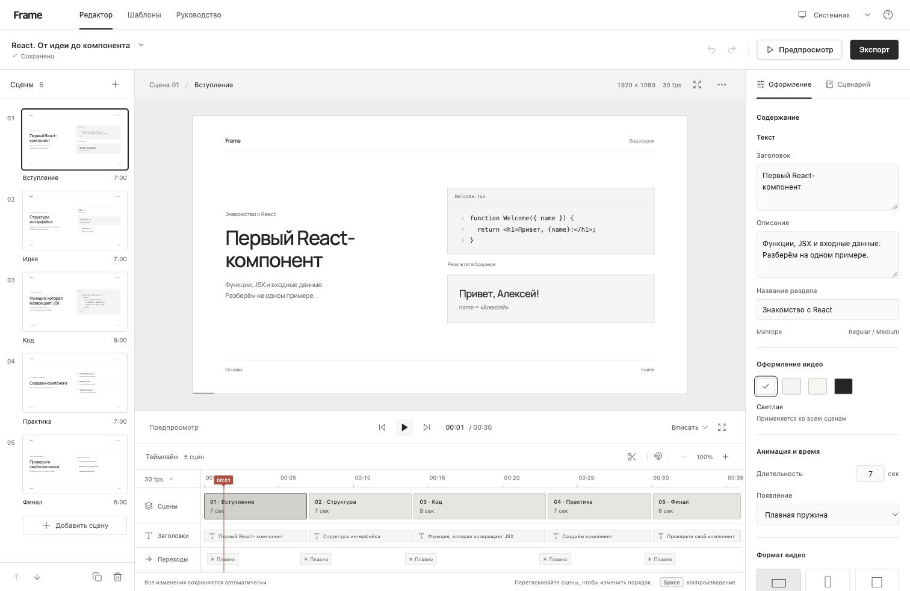

# Frame Academy

**Студия обучающих видео на React, TypeScript и Remotion.**

Frame Academy помогает автору превратить техническую тему в последовательный видеоурок: выбрать структуру, объяснить идею визуально, показать код, подготовить практику и получить MP4. Проект создан как демонстрация разработки инструментов для онлайн-образования.



## Быстрый запуск

Нужен Node.js 22+ и npm. Проверено на Node.js 24 / macOS Apple Silicon.

```bash
npm ci
npm run dev
```

Откройте **http://localhost:5173**. Одна команда запускает React-приложение и локальный сервер рендера. При первом экспорте Remotion скачает Chrome Headless Shell; для этого нужен интернет. Шрифты устанавливаются вместе с зависимостями и загружаются локально. API-ключи не нужны.

## Оформление и тема интерфейса

В правом верхнем углу доступен переключатель **Системная / Светлая / Тёмная**. По умолчанию используется системная тема. Она реагирует на смену настройки ОС без перезагрузки. Ручной выбор сохраняется отдельно от проекта в localStorage (`frame:appearance`) и синхронизируется между вкладками. Если хранилище недоступно, переключение продолжает работать в текущей сессии.

Тема интерфейса не влияет на палитру экспортируемого видео. Оформление видео выбирается отдельно в инспекторе. Интерфейс использует системный шрифт и нейтральные цвета; кадры — локальный Manrope, код и схемы без декоративных иллюстраций.

## Что можно сделать

- Редактировать пять типов сцен: вступление, визуальная идея, код, пошаговая практика, завершение.
- Изменять заголовки, описания, подписи, обучающий код и пункты объяснений.
- Выбирать одну из четырёх палитр, формат 16:9, 9:16 или 1:1 и анимацию появления.
- Управлять длительностью сцен от 2 до 30 секунд, добавлять, дублировать, удалять и менять их порядок.
- Перетаскивать клипы на таймлайне, разделять сцену в позиции курсора, перемещаться покадрово.
- Смотреть живой предпросмотр и использовать режим презентации.
- Писать заметки преподавателя отдельно от видео.
- Сохранять и открывать проекты в JSON. Автосохранение хранит текущий проект в браузере; история отмены действует в открытой сессии и сохраняет последние 50 изменений.
- Экспортировать реальный MP4/H.264 в исходном разрешении или с масштабом 2/3.
- Выгружать сценарий в Markdown и субтитры SRT с точными границами сцен.

## Четыре готовых урока

| Шаблон | Тема | Пример |
| --- | --- | --- |
| Первый компонент | React, JSX, props | Welcome |
| Живой интерфейс | useState и события | Counter |
| Видео из кода | Remotion, кадры, interpolate | FadeIn |
| Движение со смыслом | Spring и образовательная анимация | Title |

Каждый содержит пять сцен и 36 секунд видео. Применение шаблона заменяет текущий урок и доступно для отмены.

## Команды

```bash
npm run dev           # Vite + сервер рендера с перезапуском при изменениях
npm run build         # TypeScript + production-сборка
npm start             # Приложение и рендер на http://127.0.0.1:3001 (после build)
npm run studio        # Оригинальная Remotion Studio для разработчика
npm run render:demo   # Создать ../frame-academy-demo.mp4 (1920×1080)
npm test              # Тесты модели, таймингов, шаблонов и текстовых экспортов
npm run typecheck     # Проверка типов
npm run format:check  # Проверка форматирования исходников
```

`npm run preview` показывает только собранный клиент. Для MP4 используйте `npm run dev` или `npm start`.

## Как устроен проект

```text
src/
  App.tsx                  Управление студией и пользовательские действия
  components/
    Storyboard.tsx         Сцены, миниатюры и действия с последовательностью
    Inspector.tsx          Текст, палитра, анимация, содержание, сценарий
    Timeline.tsx           Дорожки, позиция, перенос и разделение сцен
    ExportModal.tsx        Запуск экспорта, опрос статуса и скачивание
    UI.tsx                 Общие кнопки и модальные окна
  lib/
    project.ts             Zod-контракт, типы, функции времени и демоурок
    templates.ts           Четыре содержательных шаблона уроков
    useProject.ts          Автосохранение и ограниченная история изменений
    exports.ts             Сценарий Markdown и субтитры SRT
  remotion/
    Lesson.tsx             Композиция, визуальные сцены и покадровая анимация
    Root.tsx               Динамические метаданные композиции
    index.ts               Точка входа для Remotion
server/
  index.ts                 HTTP API, задания, валидация и выдача файлов
  render.ts                Переиспользуемая сборка и рендер Remotion
  render-demo.ts           Генерация демонстрационного видео
```

Главное архитектурное решение: компонент `Lesson` используется и в `@remotion/player`, и в серверном `renderMedia`. Предпросмотр и экспорт получают одну модель проекта. Анимации вычисляются из номера кадра — без `Math.random`, CSS-таймеров и зависимости от скорости компьютера.

Подробнее: [архитектура](docs/architecture.md), [проверки](docs/verification.md), [демонстрация работодателю](docs/demo-guide.md).

## Границы текущей версии

Это локальное приложение для одного автора. Текущий проект сохраняется в localStorage, а перенос между компьютерами выполняется через JSON. Облачной синхронизации, аккаунтов и совместного редактирования нет.

Сервер принимает один экспорт одновременно и хранит статусы в памяти. После его перезапуска завершённые файлы остаются в `.renders`, но статусы заданий сбрасываются. Файлы текущих заданий удаляются через 24 часа непрерывной работы процесса. Ограничение проекта — 20 сцен и максимум 10 минут.

Встроенной записи голоса нет. Заметки — материал для выступления преподавателя; SRT формируется из описаний сцен, а не из распознавания речи. Демонстрационное видео содержит графику без озвучки. Примеры кода отображаются как текст и не выполняются.

## Технологии и ресурсы

React 19 · TypeScript · Remotion 4 · Vite · Express · Zod · Lucide · Manrope.

Документация: [React](https://react.dev/), [Remotion](https://www.remotion.dev/docs/), [Remotion Player](https://www.remotion.dev/docs/player/), [серверный рендер](https://www.remotion.dev/docs/ssr-node). Зависимости и шрифты распространяются на условиях их собственных лицензий.
